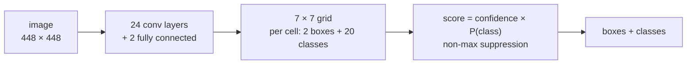
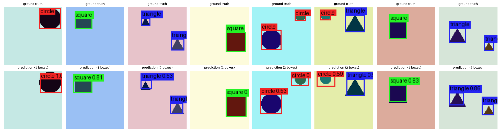
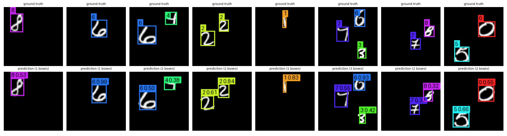
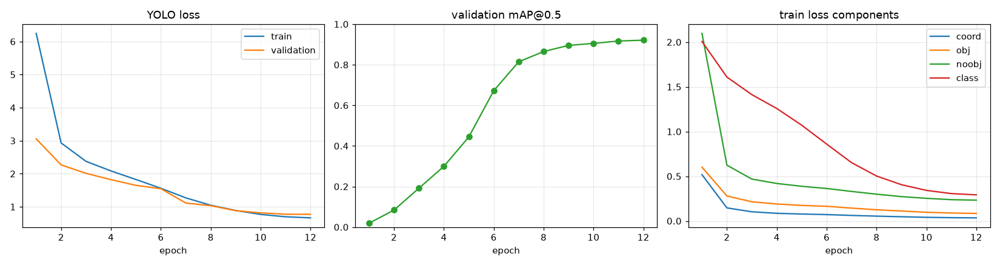

# YOLOv1 object detector

**Give it an image and it draws a box around every object it knows, with its class, in one pass.**

[](LICENSE)
[](pyproject.toml)
[](https://pytorch.org)
[](https://arxiv.org/abs/1506.02640)

A clean PyTorch implementation of **YOLOv1** ("You Only Look Once",
[Redmon et al., 2016](https://arxiv.org/abs/1506.02640)): the 24-layer network, the
sum-squared-error loss, target encoding, decoding, non-maximum suppression and mAP, written
without detection libraries or pretrained weights. It trains on synthetic shapes, MNIST digits,
PASCAL VOC or any dataset in the YOLO text format (such as the Mapillary traffic signs this
project started with), on a CPU or a free Kaggle / Colab GPU.



YOLOv1's idea: split the image into an S × S grid; the cell holding an object's centre predicts
its class and B candidate boxes with a confidence. Detection becomes a single regression, so the
network sees the whole image at once and runs in real time. See
[docs/architecture.md](docs/architecture.md).

## Quick start

```bash
# 1. install (Python >= 3.10)
git clone https://github.com/benisalla/yolo-v1-object-detector.git
cd yolo-v1-object-detector
python -m venv .venv && source .venv/bin/activate
pip install -e '.[dev]'

# 2. run the tests (CPU, no network, under a minute)
pytest

# 3. train on synthetic shapes (CPU, no download, ~40 min)
yolov1-train --dataset shapes --image-size 112 --arch small --hidden 512 \
             --train-size 2000 --val-size 200 --epochs 20 --batch-size 32 --lr 1e-3 \
             --output-dir checkpoints/shapes

# 4. train on MNIST digits scattered on a canvas (12 MB download, ~30 min)
yolov1-train --dataset mnist --root data --image-size 112 --arch small --hidden 512 --dropout 0.3 \
             --no-augment --train-size 10000 --val-size 500 --epochs 12 --batch-size 32 --lr 1e-3 \
             --output-dir checkpoints/mnist

# 5. evaluate and detect
yolov1-evaluate --checkpoint checkpoints/mnist/best.pt
yolov1-predict --checkpoint checkpoints/mnist/best.pt --images my_digits.png
```

**On a GPU:** open [`notebooks/train_kaggle_colab.ipynb`](notebooks/train_kaggle_colab.ipynb)
on Kaggle or Colab, choose the dataset (`shapes`, `mnist`, `voc` or your own `yolo` folder) and
press *Run all*. The paper network needs a GPU: 448 × 448 inputs and 271M parameters.

## Results

**Sanity check (verified by the test suite).** A small network memorises 4 shape images in
60 steps: the loss falls by more than 10× and mAP@0.5 reaches 1.0. Run
`pytest tests/test_train.py -k overfit` to reproduce it.

**Simple-data runs (CPU, `small` network, 112 × 112 inputs, 7 × 7 grid, 8.3M parameters).**

| dataset | classes | train / val images | epochs | validation mAP@0.5 | time (8-core CPU) |
|---|---|---|---|---|---|
| `shapes` | 3 | 2 000 / 200 | 20 | **0.952** (circle 0.94, square 0.97, triangle 0.94) | 25 min |
| `mnist` | 10 | 10 000 / 500 | 12 | **0.921** (lowest: digit 1 at 0.75, digit 8 at 0.88) | 26 min |

<p align="center">
  
  <br/><em>shapes validation images: ground truth (top), predictions after 20 epochs (bottom)</em>
</p>
<p align="center">
  
  <br/><em>MNIST digits: ground truth (top), predictions (bottom)</em>
</p>
<p align="center">
  
  <br/><em>MNIST run: loss, validation mAP and the four loss components per epoch</em>
</p>

Both runs are reproduced by the commands in the quick start; every run writes its own
`history.png`, `predictions.png` and `best_metrics.json`. The prediction grids above use a
display threshold of 0.3; the mAP is computed at 0.1 so that low-score boxes count for recall.
Two lessons from the MNIST run: with only 3 000 training images the same network overfits
(train loss 0.3, validation 1.6, mAP 0.55), and horizontal flips must stay off because they
change a digit's identity, so the generated datasets are trained without augmentation. [docs/testing.md](docs/testing.md)
explains how to repeat them after a change.

## Datasets

| `--dataset` | data | classes | download |
|---|---|---|---|
| `shapes` | circles, squares and triangles generated on the fly, exact boxes | 3 | none |
| `mnist` | 1 to 3 MNIST digits pasted on a canvas | 10 | 12 MB |
| `voc` | [PASCAL VOC](http://host.robots.ox.ac.uk/pascal/VOC/) 2012 or 2007, the paper's benchmark | 20 | ~2 GB |
| `yolo` | any folder of `images/` + `labels/` in the YOLO text format (`class cx cy w h`), e.g. the [Mapillary traffic signs](https://www.mapillary.com/dataset/trafficsign) export | yours | yours |

```bash
# your own data: train / val split by a seeded shuffle, class names from classes.txt
yolov1-train --dataset yolo --root data/mapillary --image-size 448 --arch yolov1 --epochs 100
```

Folder layout and all options: [docs/training.md](docs/training.md).

## Project layout

```
yolo-v1-object-detector/
├── src/yolov1/
│   ├── model.py         # the YOLOv1 network (paper architecture + a small CPU one)
│   ├── loss.py          # the paper's loss, any number of boxes per cell
│   ├── boxes.py         # IoU, target encoding, decoding, non-max suppression
│   ├── metrics.py       # mAP@IoU, VOC style
│   ├── data/            # shapes, mnist, voc, yolo-txt datasets + augmentations
│   ├── train.py         # training loop and the yolov1-train command
│   ├── evaluate.py      # the yolov1-evaluate command
│   ├── predict.py       # the yolov1-predict command (files or webcam)
│   ├── viz.py           # box drawing, prediction grids, training curves
│   └── config.py        # every setting, as dataclasses
├── tests/               # pytest: boxes, model, loss, metrics, data, overfit sanity check
├── notebooks/           # Kaggle / Colab notebook, generated from src by build_notebook.py
├── docs/                # architecture, training, testing
├── assets/              # figures of the simple-data runs
└── legacy/              # the original 2023 notebooks and the list of bugs fixed since
```

## Documentation

| guide | what is inside |
|---|---|
| [docs/architecture.md](docs/architecture.md) | the grid, the network, the loss, decoding, NMS and mAP |
| [docs/training.md](docs/training.md) | datasets, YOLO folder layout, recipes, outputs, evaluation, inference, Kaggle / Colab |
| [docs/testing.md](docs/testing.md) | what each test checks and how to re-run the simple-data checks |
| [legacy/README.md](legacy/README.md) | the original notebooks and the bugs fixed since |

## History

This project started in 2023 as two notebooks trained on Mapillary traffic signs
([`legacy/`](legacy)). It has been rewritten as a tested package. Among the problems fixed: the
test and validation CSVs were subsets of the training CSV, so the reported mAP was measured on
training images; the mAP ignored every class above 20; boxes were drawn from their centre as if
it were a corner; the second box of each cell was never used at test time.
[legacy/README.md](legacy/README.md) lists them all.

## Reference

```bibtex
@inproceedings{redmon2016yolo,
  title     = {You Only Look Once: Unified, Real-Time Object Detection},
  author    = {Redmon, Joseph and Divvala, Santosh and Girshick, Ross and Farhadi, Ali},
  booktitle = {IEEE Conference on Computer Vision and Pattern Recognition (CVPR)},
  year      = {2016}
}
```

## Author

**Ismail Ben Alla**: [LinkedIn](https://www.linkedin.com/in/ismail-ben-alla-bai/) ·
[GitHub](https://github.com/benisalla) · ismailbenalla52@gmail.com

MIT License, see [LICENSE](LICENSE).
