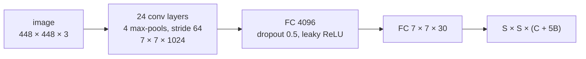

# Architecture, loss and metrics

YOLOv1 ([Redmon et al., 2016](https://arxiv.org/abs/1506.02640)) turns detection into a single
regression: one forward pass of a convolutional network outputs every box and class at once.

## The grid

The input image is split into an **S × S grid** (S = 7 in the paper). The cell that contains the
centre of an object is responsible for it. Each cell predicts:

- **C class probabilities** `P(class | object)`,
- **B boxes** (B = 2), each with a confidence `P(object) · IoU` and four coordinates
  `(x, y, w, h)`: `x, y` are the centre **offset inside the cell** (0 to 1), `w, h` are the box
  size **relative to the whole image** (stored × S in this implementation, like the reference
  code, so every target lies in the same range).

The output is a tensor of shape `(N, S, S, C + 5B)`: 7 × 7 × 30 for the 20 VOC classes.
`yolov1.boxes.encode_targets` builds this tensor from a list of boxes; `decode_predictions`
turns network outputs back into image-relative boxes with a score of `confidence × best class
probability` (the paper's class-specific confidence).

## The network



`src/yolov1/model.py` describes the network as a list: `(out_channels, kernel, stride, padding)`
is a conv → batch-norm → leaky ReLU(0.1) block, `"M"` a 2 × 2 max-pool, `[block, block, n]`
two blocks repeated n times. Two architectures are included:

| `--arch` | conv layers | stride | input for a 7 × 7 grid | parameters (20 classes, hidden 4096) |
|---|---|---|---|---|
| `yolov1` | 24 (the paper's) | 64 | 448 | 271.7M, 205M of them in the first FC layer |
| `small` | 6 | 16 | 112 | 8.3M with `--hidden 512` (CPU runs, small images) |

`--width` scales every channel count (`--width 0.5` is 4× fewer conv weights), `--hidden` and
`--dropout` set the first fully-connected layer. Batch norm is not in the paper (it is in
YOLOv2); it is added because it makes training without pretraining far easier. Outputs are
linear: the targets live in [0, 1] (offsets, confidences, probabilities) or [0, S] (sizes), and
the decoder clamps what it reads.

The paper pretrains the first 20 conv layers on ImageNet for a week. This repository trains
from random initialisation, which is why the simple datasets matter: they show the pipeline
learns without that head start.

## The loss (`src/yolov1/loss.py`)

Sum-squared error, equation 3 of the paper, with the batch mean taken at the end:

```
λ_coord · Σ_resp [ (x − x̂)² + (y − ŷ)² + (√w − √ŵ)² + (√h − √ĥ)² ]    coordinates
        + Σ_resp (1 − Ĉ)²                                             confidence of responsible boxes
+ λ_noobj · Σ_not resp Ĉ²                                             confidence of every other box
        + Σ_obj cells Σ_c (p(c) − p̂(c))²                              class probabilities
```

- A predictor is **responsible** for an object when its box has the highest IoU with the ground
  truth among the B boxes of that cell (computed without gradient every step).
- `λ_coord = 5`, `λ_noobj = 0.5` as in the paper (`--lambda-coord`, `--lambda-noobj`).
- The square roots make a 5-pixel error matter more on a small box than on a large one.
  `sign(ŵ)·√|ŵ|` keeps the gradient defined when the network predicts a negative size.
- The loss object keeps the four components (`last_components`) and the training curves plot
  them: a rising no-object term with a flat coordinate term usually means the confidence
  threshold is too low, not that the model is broken.

## Decoding, NMS and mAP

1. `decode_predictions`: for all S·S·B boxes, score = `clamp(confidence) · clamp(max class prob)`,
   coordinates converted to image-relative centre / size.
2. `non_max_suppression`: boxes below `--conf-threshold` are dropped; the rest are taken by
   decreasing score and any box of the **same class** that overlaps a kept one with IoU above
   `--nms-iou` is suppressed.
3. `mean_average_precision` (`src/yolov1/metrics.py`): for every class, detections of all images
   are sorted by score; a detection is a true positive when its IoU with an unmatched ground-truth
   box of the same image is ≥ `--map-iou` (0.5). Precision / recall are accumulated along the
   sorted list and AP is the area under the precision envelope (VOC 2010+ "all points"
   interpolation). mAP is the mean over the classes that have at least one ground-truth box.

The decoding, NMS and mAP code is tested against hand-computed examples in
[`tests/`](../tests), see [testing.md](testing.md).
